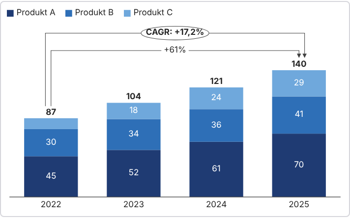

# Wykresy – dodatek do PowerPointa

Dodatek Office (Office.js, TypeScript, React) do szybkiego tworzenia wykresów biznesowych w PowerPoincie, wzorowany na think-cell.



## Co potrafi (wersja 0.2)

- **10 typów wykresów:** kolumnowy grupowany, skumulowany i 100%, słupkowy grupowany i skumulowany, liniowy, kołowy, pierścieniowy, kaskadowy (waterfall, z automatycznymi sumami „e”) oraz punktowy / bąbelkowy.
- **Wykres punktowy (scatter):** arkusz z kolumnami etykieta, X, Y, wielkość, grupa; wielkość kropek proporcjonalna do wybranej cechy (bąbelki) albo stała; dla każdej grupy osobny kształt (okrąg, trójkąt, kwadrat, krzyżyk, romb, sześciokąt) w wersji pełnej lub pustej; tytuły osi z nagłówków, etykiety punktów, opcjonalna siatka.
- **Arkusz danych w panelu bocznym:** układ jak w think-cell (kategorie w pierwszym wierszu, serie w pierwszej kolumnie), wklejanie zakresów prosto z Excela (Ctrl+V), dodawanie i usuwanie serii oraz kategorii, transpozycja.
- **Excel:** import zakresu z pliku `.xlsx` (wybór arkusza i zakresu, np. `B3:E5`), zapamiętane łącze i przycisk „Odśwież z Excela”.
- **Palety kolorów:** 8 wbudowanych (m.in. biznesowa, stonowana, kontrastowa, przyjazna daltonistom) oraz własna paleta z edytorem; ostatnio użyta paleta staje się domyślną.
- **Etykiety i adnotacje:** etykiety wartości z kontrastowym kolorem, sumy nad kolumnami, legenda, opcjonalna oś wartości z siatką, strzałka różnicy (wartość lub %), strzałka CAGR, format liczb (miejsca po przecinku, jednostka, separator).
- **Natywne kształty PowerPointa:** wykres to zgrupowane kształty, więc wygląda tak samo u osób bez dodatku. Definicja wykresu jest zapisana w tagach grupy: zaznacz wykres, a panel wczyta jego dane do edycji.
- **Zmiana rozmiaru:** przeciągnij ramkę wykresu na slajdzie i kliknij „Aktualizuj wykres” (lub zostaw włączone „na bieżąco”), a układ przeliczy się do nowego rozmiaru zamiast się rozciągać.

## Uruchomienie lokalne

Wymagania: Node.js 20+ i PowerPoint (Microsoft 365 na Windows lub Mac, albo PowerPoint w przeglądarce).

```bash
npm install
npm run certs      # jednorazowo: instaluje zaufany certyfikat dla https://localhost
npm start          # uruchamia serwer i otwiera PowerPointa z załadowanym dodatkiem
```

Przycisk **Wykresy** pojawi się na karcie **Narzędzia główne**. Aby zatrzymać: `npm run stop`.

**PowerPoint w przeglądarce:** uruchom `npm run dev`, a potem w PowerPoincie wybierz *Narzędzia główne → Dodatki → Więcej dodatków → Moje dodatki → Przekaż mój dodatek* i wskaż plik `manifest.xml`.

Sam panel można też otworzyć w zwykłej przeglądarce pod `https://localhost:3000/taskpane.html` – działa wtedy podgląd wykresów bez wstawiania na slajd.

## Jak używać

1. Kliknij **Wykresy** na wstążce.
2. Wybierz typ wykresu, wklej dane z Excela do arkusza (albo zaimportuj plik `.xlsx`).
3. Wybierz paletę i adnotacje, sprawdź podgląd i kliknij **Wstaw wykres na slajd**.
4. Aby edytować, zaznacz wykres na slajdzie: panel przełączy się w tryb edycji.

Przykładowy plik do importu: `tests/fixtures/sprzedaz.xlsx` (arkusz „Sprzedaż”, zakres `B3:E5`).

## Instalacja na stałe (bez PowerShell)

Panel dodatku to strona internetowa, więc musi być opublikowana pod adresem HTTPS. Potem PowerPoint ładuje dodatek sam przy każdym uruchomieniu, a Node.js nie jest potrzebny.

**Publikacja – wybierz jedno:**

- **GitHub Pages (automatycznie):** w repozytorium jest workflow `.github/workflows/pages.yml`. Po włączeniu *Settings → Pages → Source: GitHub Actions* każda zmiana w gałęzi `main` buduje, testuje i publikuje dodatek. Manifest jest pod `https://<użytkownik>.github.io/<repozytorium>/manifest.xml`.
- **Dowolny hosting statyczny (np. Netlify Drop):** `npm run build`, wgraj zawartość `dist/`, a potem `npm run manifest -- https://adres-hostingu` utworzy `dist/manifest.xml` z właściwymi adresami.

**Instalacja manifestu w PowerPoincie (raz):**

- *Microsoft 365 (konto służbowe lub szkolne):* Narzędzia główne → Dodatki → Więcej dodatków → Moje dodatki → **Przekaż mój dodatek** → wskaż `manifest.xml`.
- *Windows, gdy tej opcji nie ma:* udostępnij folder z manifestem (np. `C:\Dodatki`), dodaj jego adres sieciowy (`\\NAZWA-KOMPUTERA\Dodatki`) w Plik → Opcje → Centrum zaufania → Ustawienia → Wykazy zaufanych dodatków, zaznacz „Pokaż w menu”, uruchom PowerPointa ponownie i wybierz Moje dodatki → Folder udostępniony → Wykresy.
- *Cała firma:* administrator Microsoft 365 wdraża manifest w *Centrum administracyjnym → Ustawienia → Zintegrowane aplikacje*; przycisk pojawia się wtedy wszystkim automatycznie.

## Wymagania i ograniczenia

- Pełne możliwości wymagają PowerPointApi 1.10 (aktualny Microsoft 365). W starszych wersjach wykresy kołowe, pierścieniowe i liniowe są wstawiane jako obraz SVG (nadal edytowalne przez panel), a wykresy kolumnowe działają od PowerPointApi 1.8.
- Dodatek w przeglądarce nie może sam czytać pliku z dysku, dlatego „Odśwież z Excela” prosi o ponowne wskazanie pliku; arkusz i zakres są zapamiętane.
- Edycja odbywa się w panelu bocznym; przeciąganie uchwytów etykiet bezpośrednio na wykresie (jak w think-cell) nie jest dostępne w Office.js.

## Struktura

```
src/core/       silnik wykresów niezależny od Office: dane, palety, układ, eksport SVG
src/office/     PowerPoint (rysowanie kształtów, tagi, aktualizacja) i import Excela
src/taskpane/   panel boczny (React)
tests/          testy jednostkowe (Vitest), w tym na atrapie API PowerPointa
manifest.xml    manifest dodatku
```

Testy: `npm test`. Kontrola typów: `npm run typecheck`.
